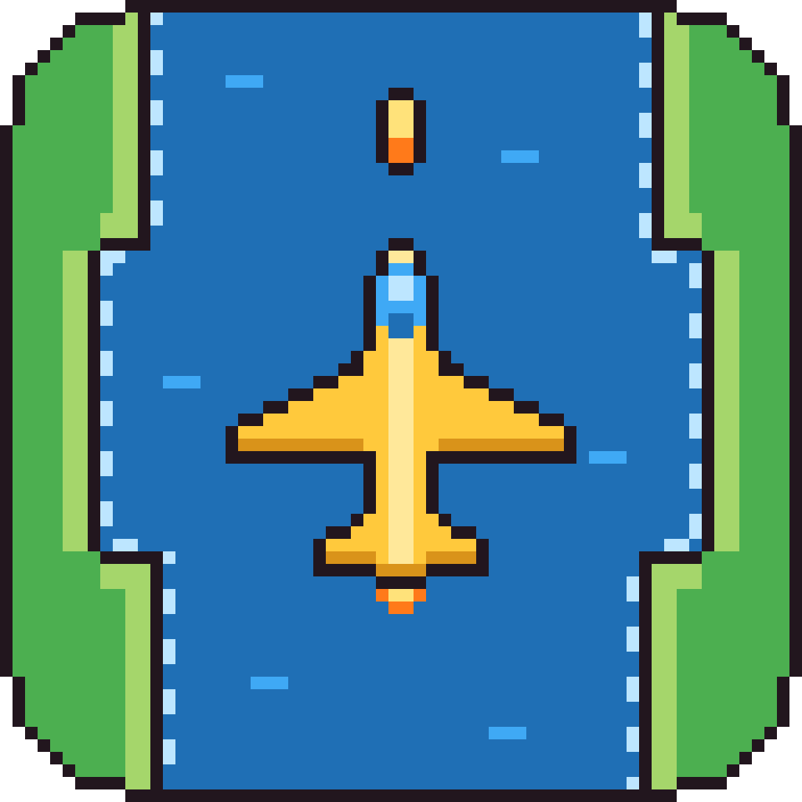
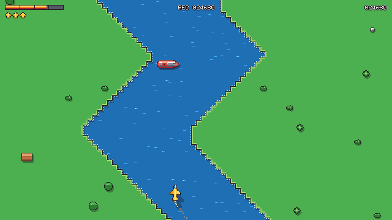
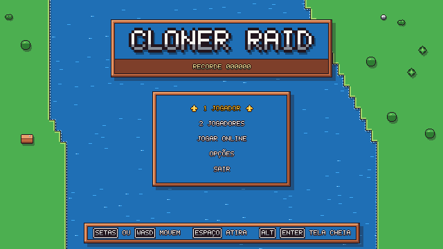
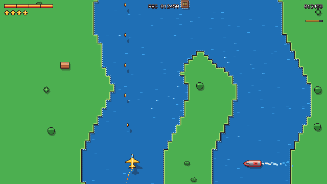

<p align="center">
  
</p>

<h1 align="center">Cloner Raid</h1>

<p align="center">
  Shooter 2D de rolagem vertical sobre um rio, em pixel art.<br>
  Desvie das margens, derrube inimigos, destrua pontes e não deixe o combustível acabar.
</p>

<p align="center">
  
</p>

Inspirado nos shooters de rio dos anos 80, com um toque moderno: combo, power-ups, efeitos de
impacto, controle e menus completos. Toda a arte, os sons, a música e o rio são **gerados por
código** (sem nenhum asset de terceiros).

Feito em [Godot 4.7](https://godotengine.org/) (GDScript).

## Download

Os executáveis para **Windows**, **macOS** e **Linux** ficam na página de
[Releases](../../releases). Baixe o `.zip` do seu sistema, descompacte e jogue.

O jogo não tem assinatura paga da Microsoft nem da Apple, então na primeira vez o sistema
avisa que o desenvolvedor não é conhecido:

- **Windows:** se aparecer "O Windows protegeu o computador", clique em **Mais informações** →
  **Executar assim mesmo**.
- **macOS:** abra o app uma vez (o Mac vai bloquear), depois vá em **Ajustes do Sistema →
  Privacidade e Segurança**, role até o aviso do Cloner Raid e clique em **Abrir Mesmo Assim**.
  Se o Mac disser que o app "está danificado", rode no Terminal, na pasta onde ele está:
  `xattr -dr com.apple.quarantine ClonerRaid.app`
- **Linux:** se não abrir com dois cliques, dê permissão de execução no terminal:
  `chmod +x ClonerRaid.x86_64`

## Como jogar

| | |
|---|---|
|  |  |

- **Combustível:** o tanque esvazia sozinho. Passe por cima dos postos flutuantes para
  reabastecer (freando em cima, enche mais). Se acabar, o avião cai.
- **Margens e ilhas:** encostar na terra derruba o avião, e o tiro não atravessa a terra.
- **Pontes:** destrua a ponte no fim de cada trecho para salvar o progresso. Ao cair, você
  recomeça logo depois da última ponte destruída.
- **Combo:** derrube inimigos em sequência (3 s entre um e outro) para multiplicar os pontos
  até **x4**. Atirar num posto quebra o combo.
- **Power-ups:** caixas flutuando no rio. Passe por cima para pegar; se atirar nelas, elas
  explodem.
  - **Tiro duplo:** dois tiros por disparo durante 10 s.
  - **Escudo:** segura uma batida em inimigo durante 15 s (não protege da margem nem da falta
    de combustível).
  - **Vida extra:** rara, só nos trechos mais avançados.
- **Vidas extras:** também vêm com os pontos, cada vez mais caras (5 mil, 15 mil, 30 mil...).
- A dificuldade cresce a cada ponte: rio mais estreito e curvo, mais inimigos e mais rápidos.

## Controles

Todos os comandos podem ser trocados em **OPÇÕES → CONTROLES** (teclado e controle).

| Ação | Teclado | Controle |
|---|---|---|
| Mover | Setas ← → ou A / D | Analógico ou direcional |
| Acelerar / frear | Setas ↑ ↓ ou W / S | Analógico ou direcional |
| Atirar | Espaço ou J | A |
| Pausar | Esc ou P | Start |
| Confirmar / voltar nos menus | Enter / Esc | A / B |
| Tela cheia | F11, Alt+Enter ou Ctrl+Cmd+F (Mac) | — |

Opções: tela cheia, volume da música e dos efeitos, tremor de tela (e vibração do controle)
e se os pontos no coop são juntos ou separados.

### 2 jogadores (coop local)

Escolha **2 JOGADORES** no título. Com algum controle conectado, uma tela pergunta quem joga
no **teclado** e quem no **controle** (←/→ trocam). Quem fica sozinho no teclado usa o
teclado inteiro (WASD ou setas, Espaço ou Enter). Sem controle, os dois dividem o teclado:

| Ação | Jogador 1 (amarelo) | Jogador 2 (lilás) |
|---|---|---|
| Mover / acelerar / frear | W A S D | Setas |
| Atirar | Espaço ou J | Enter |

No controle: analógico ou direcional para mover e **A** para atirar.

### Online pela Steam

Escolha **JOGAR ONLINE** (a Steam precisa estar aberta nos dois computadores):

- **CRIAR SALA** mostra um código de 6 letras. Use **COPIAR CÓDIGO** e mande para o amigo, ou
  **CONVIDAR AMIGO** para escolher um dos seus amigos online da Steam: ele recebe o convite no
  chat da Steam (precisa estar com o Cloner Raid aberto para entrar direto).
- **ENTRAR COM CÓDIGO**: digite o código que o amigo mandou (ou cole com Ctrl+V / Cmd+V).

Quando o amigo entra, os dois vão para o **saguão**: o anfitrião escolhe se os pontos são
juntos ou separados e começa a partida quando estiverem prontos. Cada um pilota o seu avião
com o próprio teclado ou controle. Na Steam, o jogo aparece como **"Spacewar"**: é o app de testes da Valve
que o Cloner Raid usa para as salas, já que ele não está publicado na loja.

### Regras do coop

Cada um tem o próprio combustível e as próprias vidas. Quem cai renasce ao lado do outro; se
os dois caírem, recomeçam juntos da última ponte. A tela acompanha o avião de trás, e o da
frente não passa do topo da tela.

## Rodar pelo código

1. Instale o [Godot 4.7](https://godotengine.org/download) (versão padrão, sem .NET).
2. Clone este repositório e abra o `project.godot` no Godot.
3. Aperte **F5**.

> **Dica:** se o Godot for o da Steam e o controle não funcionar, desative o *Steam Input* do
> Godot Engine na Steam (Propriedades → Controle) ou abra o `Godot.app`/`Godot.exe` direto,
> sem passar pela Steam.

### Arte e sons gerados por código

Nada de arte ou som foi desenhado à mão em programa de imagem: tudo sai de scripts Python
(só a biblioteca padrão, sem instalar nada).

- **Sprites:** `tools/sprites/` — cada sprite é uma grade de caracteres (1 caractere = 1 pixel)
  com uma paleta única em `style.py`. Ex.: `python3 tools/sprites/player.py`
- **Efeitos sonoros:** `python3 tools/audio/sfx.py` (síntese estilo chiptune)
- **Música:** `python3 tools/audio/music.py` (3 camadas que entram conforme você avança)
- **Ícone:** `python3 tools/sprites/icon.py`

Depois de gerar, abra o projeto no Godot (ou rode `godot --headless --path . --import`) para
importar os arquivos novos.

### Estrutura

```
scenes/        cenas do Godot (title.tscn = tela de título, main.tscn = partida)
scripts/       scripts GDScript (um por cena principal)
assets/        sprites, sons, música, shaders e ícone gerados
tools/         geradores de sprites e áudio (Python)
docs/          imagens deste README
```

O rio é procedural e dividido em trechos que terminam numa ponte. Cada trecho é sorteado a
partir de uma semente, então, ao recomeçar depois de uma queda, ele sai exatamente igual.

## Próximos passos

Depois da versão 1.0: **modo cooperativo** local e online.
